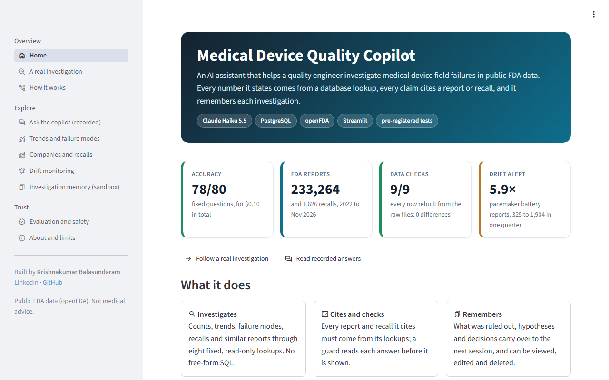

# Medical Device Quality Copilot

An AI assistant that helps a medical device quality engineer investigate field failures from public FDA data, citing the exact reports.

**Live app:** [medical-device-copilot.streamlit.app](https://medical-device-copilot.streamlit.app) · [Case study](docs/CASE_STUDY.md) · [Results](docs/RESULTS.md) · [Docs](docs/README.md)



**Headline results**

- **Cheap model, no significant loss:** on 80 pre-registered questions, Claude Haiku 5.5 answered 78 correctly for $0.10; Claude Opus 5.5 answered 76 for $4.01. The difference is not significant (McNemar p 0.625), so the cheap model stays.
- **Early warning:** 15 of 38 recall events were preceded by an early-warning signal (39%), against a 14% base rate for any window.
- **A real case:** in Boston Scientific pacemaker battery reports, the share from the recalled device families rose from 77.9% to 97.5% after the 2025 recall began. The data show timing, not cause.

Report counts are not failure rates: there is no count of devices in use, and a report does not prove the device caused the event.

**Built with:** Python · PostgreSQL · openFDA API · pandas · scikit-learn · BM25 + bge-small embeddings · Claude Haiku 5.5 (Anthropic SDK, own agent loop) · Streamlit · Power BI · GitHub Actions. Total recorded API spend for the whole project: $4.50.

## The problem

When a device starts failing in the field, a quality engineer has to answer questions fast: are complaints about this product rising, which failure modes, did a similar device get recalled and why, and what did we already rule out last week? The public evidence (FDA MAUDE adverse-event reports and recall records) is large, messy free text, and investigations run for weeks across many sessions.

## What it does

- Answers investigation questions from openFDA adverse-event reports and recalls, citing the exact report numbers.
- Groups reports into failure modes, shows trends and statistical early-warning signals, and links them to recalls.
- Remembers each open investigation (hypotheses, what was ruled out and why, decisions), with a page to view, export and delete that memory.
- Watches new reports for drift and checks every answer with a safety guard before it is shown.

## Status

| Phase | State |
|---|---|
| 0 Setup | Done: repository, CI on every push, pre-registration convention |
| 1 Data | Done: 154,194 adverse-event reports (2022-2024) and 1,626 recalls for 5 device types, equal to openFDA's own counts; [findings](docs/EDA_FINDINGS.md) |
| 2 Pipeline | Done: PostgreSQL star schema, personal fields never stored, 305 maker names merged into 101 companies; [pipeline](docs/PIPELINE.md) |
| 3 Failure modes | Done: FDA problem terms mapped by a codebook (70% on test) beat text methods (embeddings 32%); 214 early-warning signals, 15 of 38 recall events preceded by one (39% vs a 14% base rate); [failure modes](docs/FAILURE_MODES.md) |
| 4 Assistant | Done: Claude Haiku 5.5 with read-only database tools, its own agent loop, cost ledger and budget stop; citations traceable 23/23; [assistant](docs/ASSISTANT.md) |
| 5 Memory | Done: remembers each investigation across sessions (hypotheses, ruled out, decisions), with view, edit, export and real delete; [memory](docs/MEMORY.md) |
| 6 Evaluation | Done: 85 pre-registered questions; Haiku 78/80 for $0.10 vs Opus 5.5 76/80 for $4.01 (McNemar p 0.625): the cheap model stays; [evaluation](docs/EVALUATION.md) |
| 7 Safety and drift | Done, scorecard 4/5: the guard withheld 24 of 48 safe red-team answers, so that criterion is **not met**; drift checks on 79,075 new reports raised 5 flags in 105 checks, led by a pacemaker battery surge; [safety and drift](docs/SAFETY_AND_DRIFT.md) |
| 7b New guard | Done: a quoting guard caught 38/40 planted unsafe sentences and withheld 0/40 clean answers, but the labels came from an AI with no human check; [guard](docs/GUARD_7B.md) |
| 7c 2025-2026 data | Done: 233,264 reports (2022-2026) rebuilt from raw in a second schema, checks 9/9; Haiku 20/20 on questions over the larger data; [data](docs/DATA_2025_2026.md) |
| 8 App and Power BI | Done: [live app](https://medical-device-copilot.streamlit.app) replaying recorded answers, and a Power BI report on exported files, 80 exported values checked (scorecard 5/5); [app](docs/APP.md), [Power BI](docs/POWERBI_GUIDE.md) |
| 9 Write-up | Done: this README, [case study](docs/CASE_STUDY.md), [results](docs/RESULTS.md), [architecture](docs/ARCHITECTURE.md), [decisions](docs/DECISIONS.md), all generated from the results files and checked |

Every phase pre-registered its criteria in a commit before its results, and ends with an independent verifier that runs in CI.

## How it works

openFDA downloads go through a validated pipeline into PostgreSQL. A codebook maps FDA problem terms to failure modes, and a Poisson rule flags unusual months. The assistant (Claude Haiku 5.5) answers only through read-only database tools and investigation memory, and a guard checks the answer. The app and the Power BI report read exported snapshots, so the public demo needs no API key or database. Details: [architecture](docs/ARCHITECTURE.md), [decisions](docs/DECISIONS.md).

## Check it without the data

CI runs this block verbatim on Python 3.14 (ubuntu-24.04): the tests and the offline verifiers re-check the published results from the committed files.

```bash
pip install -r requirements.txt
pytest
python -m mdqc.verify_phase3 --offline
python -m mdqc.verify_phase6 --offline
python -m mdqc.verify_phase7 --offline
python -m mdqc.verify_phase7b
python -m dashboards.verify_phase8
python -m writeup.report_phase9 --check
python -m writeup.verify_phase9
```

## Run the full pipeline

Needs PostgreSQL 17 and a few hours (mostly the embeddings). The paid steps ask for a cost estimate and a yes first.

```powershell
python -m venv .venv
.venv\Scripts\python -m pip install -r requirements.txt
.venv\Scripts\python -m mdqc.setup_env       # optional: free openFDA key, hidden prompt, saved to .env
.venv\Scripts\python -m mdqc.download        # about 1 GB transfer, 68 MB stored, no key needed
.venv\Scripts\python -m mdqc.verify_phase1
.venv\Scripts\python -m mdqc.db_setup        # once: PostgreSQL database + login (password into .env)
.venv\Scripts\python -m mdqc.load
.venv\Scripts\python -m mdqc.verify_phase2
.venv\Scripts\python -m pip install -r requirements-embed.txt   # Phase 3 embedding model (CPU PyTorch first: see the file)
.venv\Scripts\python -m mdqc.embed            # about 2.4 h on a laptop CPU, once
.venv\Scripts\python -m mdqc.run_phase3
.venv\Scripts\python -m mdqc.verify_phase3
.venv\Scripts\python -m mdqc.run_phase4 --scripted   # free pipeline proof (no model)
.venv\Scripts\python -m mdqc.replay Q1             # replay a recorded investigation for free
.venv\Scripts\python -m mdqc.run_phase5
.venv\Scripts\python -m mdqc.memory list           # investigation memory: list | show | export | delete-item | delete
.venv\Scripts\python -m mdqc.run_phase6           # Phase 6 cost estimate (free); --live is the paid run
.venv\Scripts\python -m mdqc.verify_phase6
.venv\Scripts\python -m mdqc.drift --baseline      # Phase 7 drift: --download fetches new reports, --check runs the checks
.venv\Scripts\python -m mdqc.verify_phase7
.venv\Scripts\python -m mdqc.load_all --raw --load --analytics --embed   # Phase 7c: 2022-2026 data beside core
.venv\Scripts\python -m mdqc.verify_phase7c        # about 45 minutes
.venv\Scripts\python -m dashboards.export_snapshots   # app snapshots (the app has its own env from app/requirements.txt)
.venv\Scripts\python -m dashboards.verify_phase8 --local
.venv\Scripts\python -m dashboards.powerbi_export     # CSV files for the Power BI report (no database login)
.venv\Scripts\python -m dashboards.verify_powerbi
```

## Limitations

- Report counts are not failure rates (no denominator of devices in use).
- FDA data are unvalidated and reports do not prove a device caused an event.
- The latest quarter is incomplete because reports keep arriving.
- The failure-mode codebook agrees with hand labels about 70% of the time (61% to 79% on the test set), and those labels were made by Claude, not a domain expert.
- Phase 7 red-team criterion not met (guard withheld safe answers): 24 of 48 safe answers were withheld, so Phase 7 scored 4/5.
- Phase 7b labels came from an AI, with no human check (Claude Opus 5.5 labelled them; the user declined to label).
- The 7b guard was not re-tested on the 2025-2026 data, and the 78/80 accuracy was measured on 2022-2024 data only.
- The live app and the Power BI report are snapshots, not live data: they replay recorded answers and exported files.

## Data and licence

Data: [openFDA](https://open.fda.gov/) device endpoints (public domain). FDA's disclaimer applies: the data are unvalidated and must not be used for medical decisions. Personal and contact fields are dropped on load.

## Author

**Krishnakumar Balasundaram**, MS Business Analytics candidate at the Isenberg School of Management, UMass Amherst (expected May 2028). B.E. Mechanical Engineering, with industry experience in production, quality control and operations analytics in manufacturing.

[LinkedIn](https://www.linkedin.com/in/krishnakumar-balasundaram-3a92b6422) · [GitHub](https://github.com/Krishna6116) · [Live app](https://medical-device-copilot.streamlit.app) · [Case study](docs/CASE_STUDY.md)

Built with Claude Code as a coding assistant; every criterion, choice and published claim was reviewed by the author, and the verifiers re-check the numbers.
