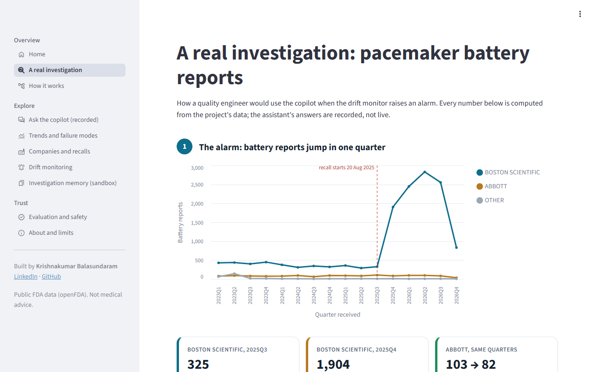
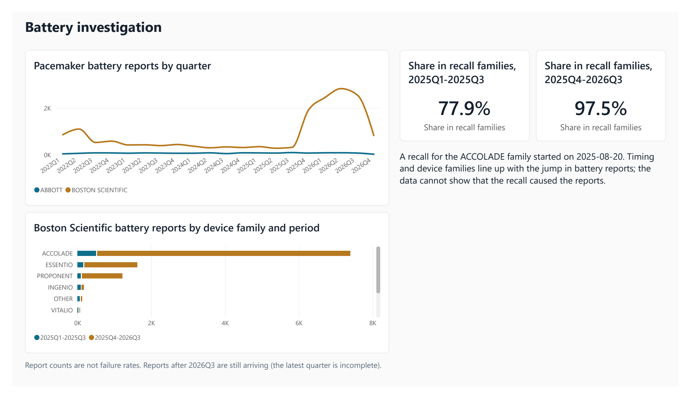

# Medical Device Quality Copilot

An AI assistant that helps a medical device quality engineer investigate field failures from public FDA data, citing the exact reports.

**[Try the live app](https://medical-device-copilot.streamlit.app)**: a guided investigation of a real 2025 pacemaker battery-report surge, trends and failure modes by product, recorded assistant answers with citations, and the investigation memory. No install or API key needed.

[](https://github.com/krishna6116/Medical-Device-Quality-Copilot/actions/workflows/ci.yml) [](https://www.python.org/) [](https://github.com/krishna6116/Medical-Device-Quality-Copilot/releases/tag/v1.0.0) [](LICENSE) [](https://medical-device-copilot.streamlit.app)

           

**[▶ Live app](https://medical-device-copilot.streamlit.app) · [Results](#results-at-a-glance) · [The problem](#the-problem) · [How it works](#how-it-works) · [Skills](#skills-demonstrated) · [Check it](#check-it-without-the-data) · [Limitations](#limitations-and-what-i-would-do-next) · [Author](#author)**

**TL;DR**

- **Problem:** when complaints about a device rise, quality engineers must work out what is failing, how fast, and whether similar devices were recalled, from hundreds of thousands of messy FDA reports.
- **Built end to end:** openFDA download and validated PostgreSQL pipeline, failure-mode classification and early-warning signals, a tool-using Claude assistant that cites reports and remembers each investigation, a safety guard, drift monitoring, a Streamlit app and a Power BI report, with every result re-checked by independent code in CI.
- **Cheap model, no significant loss:** on 80 pre-registered questions, Claude Haiku 5.5 answered 78 correctly for $0.10; Claude Opus 5.5 answered 76 for $4.01 (McNemar p 0.625), so the cheap model stays.
- **Early warning:** 15 of 38 recall events were preceded by an early-warning signal (39%), against a 14% base rate for any window.
- **A real case:** in Boston Scientific pacemaker battery reports, the share from the recalled device families rose from 77.9% to 97.5% after the 2025 recall began. The data show timing, not cause.

Report counts are not failure rates: there is no count of devices in use, and a report does not prove the device caused the event.

**Built with:** Python · PostgreSQL · openFDA API · pandas · scikit-learn · BM25 + bge-small embeddings · Claude Haiku 5.5 (Anthropic SDK, own agent loop) · Streamlit · Power BI · GitHub Actions. Total recorded API spend for the whole project: $4.50.


## Project at a glance

| | |
| --- | --- |
| **What it does** | Answers a quality engineer's investigation questions from FDA adverse-event reports and recalls, with every number from a database lookup and every claim citing a report or recall, and remembers each investigation across sessions |
| **Data** | openFDA MAUDE adverse-event reports and device recalls for 5 device types (hip and knee implants, a pacemaker, an insulin pump): 233,264 reports (2022-2026) and 1,626 recalls, equal to openFDA's own counts |
| **Data engineering** | PostgreSQL star schema with validation rules, a quarantine table, personal fields dropped on load and 305 maker names merged into 101 companies |
| **NLP and statistics** | Failure-mode classification (codebook over FDA terms vs keyword, TF-IDF and embedding baselines), BM25 and embedding search, Poisson early-warning signals backtested against recalls |
| **AI engineering** | Claude Haiku 5.5 in its own agent loop with read-only database tools, prompt caching, a cost ledger and budget stop, per-investigation memory with real deletion, a quoting safety guard and recorded replays |
| **Evaluation** | Pre-registered question set with SQL gold answers, literal grading re-checked by separate code, a Haiku vs Opus comparison with McNemar's test, red-team tests |
| **Dashboards** | Public Streamlit app on frozen snapshots and a Power BI report generated as project files from exported CSVs, both checked value by value |
| **Engineering** | pytest suite, GitHub Actions CI with an independent verifier for every phase, pre-registered success criteria, generated docs |

## Results at a glance

| What | Result | Compared with |
| --- | --- | --- |
| Assistant accuracy on 80 pre-registered questions | **Haiku 5.5 78/80 (97.5%) for $0.10** | Opus 5.5 76/80 (95.0%) for $4.01; McNemar p 0.625 |
| Recall events preceded by an early-warning signal | **15 of 38 (39%)** | 14% base rate for any window |
| Failure-mode classification, held-out test | **codebook 70%** (61% to 79%) | text embeddings 32% |
| Pacemaker battery reports from the recalled families | **97.5% after the recall** | 77.9% before (timing, not cause) |
| Safety guard (Phase 7b), planted unsafe sentences caught | **38/40**, clean answers withheld 0/40 | labels from an AI, no human check |
| Whole project, recorded API spend | **$4.50** | one paid evaluation run, everything else replayed or local |

Every number on this page is generated from the results files and re-checked by independent code on every push. Full results: [docs/RESULTS.md](docs/RESULTS.md).

## The problem

When a device starts failing in the field, a quality engineer has to answer questions fast: are complaints about this product rising, which failure modes, did a similar device get recalled and why, and what did we already rule out last week? The public evidence (FDA MAUDE adverse-event reports and recall records) is large, messy free text, and investigations run for weeks across many sessions.

## How it works

1. **Data:** openFDA downloads are checked against the server's own counts and checksums, then loaded into a PostgreSQL star schema; broken records go to a quarantine table and personal fields are never stored.
2. **Failure modes and signals:** a codebook maps FDA problem terms to failure modes, and a Poisson rule flags months with unusually many reports for a product, company and mode.
3. **Assistant:** Claude Haiku 5.5 answers only through read-only database tools (counts, trends, failure modes, report search, recalls, signals) and cites what they return; a cost ledger stops it at a budget.
4. **Memory:** each investigation keeps its hypotheses, ruled-out causes and decisions across sessions, with view, export and real delete.
5. **Safety and drift:** a guard checks each answer for medical advice, personal data and causal claims; drift checks watch newer reports.
6. **Dashboards:** the Streamlit app and the Power BI report read exported snapshots, so the public demo needs no API key or database.





Details: [architecture](docs/ARCHITECTURE.md), [decisions](docs/DECISIONS.md), [case study](docs/CASE_STUDY.md).

## What makes this trustworthy

- **Pre-registered:** every phase committed its success criteria before its results; changes made afterwards are labelled post hoc.
- **Independently verified:** each phase ends with a verifier that recomputes the results a different way, and it runs in CI.
- **Honest about misses:** Phase 7 scored 4/5 and stays published that way; the 7b guard's labels came from an AI and are reported as such.
- **No made-up numbers:** answers are graded on numbers and citations traceable to tool results (23/23 citations in the live test).

## Skills demonstrated

Medical device quality and post-market surveillance · Complaint and failure-mode analysis · Signal detection and statistics · Data pipelines and SQL (PostgreSQL) · NLP and semantic search · LLM agents with tool use (Claude) · LLM evaluation and red-teaming · AI safety guardrails · Drift monitoring · BI dashboards (Streamlit, Power BI) · Automated testing and CI/CD (pytest, GitHub Actions)

| Job function | What this project shows | Proof |
| --- | --- | --- |
| Quality and regulatory analytics | Failure modes, trends and recalls from FDA MAUDE data, with report counts never presented as rates | [config/failure_modes.json](config/failure_modes.json) · [docs/CASE_STUDY.md](docs/CASE_STUDY.md) |
| Data engineering | openFDA client with paging and checksums, PostgreSQL star schema, validation and quarantine | [mdqc/openfda.py](mdqc/openfda.py) · [mdqc/schema.sql](mdqc/schema.sql) · [mdqc/load.py](mdqc/load.py) |
| Data science and statistics | Classification baselines chosen on validation, Poisson signals backtested against recalls, McNemar test | [mdqc/run_phase3.py](mdqc/run_phase3.py) · [mdqc/run_phase6.py](mdqc/run_phase6.py) |
| AI engineering | Tool-using agent loop, cost ledger, prompt caching, memory with real deletion, recorded replays | [mdqc/tools.py](mdqc/tools.py) · [mdqc/assistant.py](mdqc/assistant.py) · [mdqc/memory.py](mdqc/memory.py) |
| AI evaluation and safety | Pre-registered grading, red-team set, quoting guard, drift checks | [mdqc/grade.py](mdqc/grade.py) · [mdqc/guard2.py](mdqc/guard2.py) · [mdqc/drift.py](mdqc/drift.py) |
| BI and dashboards | Streamlit app on frozen snapshots, Power BI report generated as project files, both checked against independent numbers | [app/streamlit_app.py](app/streamlit_app.py) · [dashboards/build_pbip.py](dashboards/build_pbip.py) |
| Engineering practice | CI with an independent verifier per phase, generated docs, planted-bug tests | [.github/workflows/ci.yml](.github/workflows/ci.yml) · [writeup/verify_phase9.py](writeup/verify_phase9.py) |

## Status

| Phase | State |
|---|---|
| 0 Setup | Done: repository, CI on every push, pre-registration convention |
| 1 Data | Done: 154,194 adverse-event reports (2022-2024) and 1,626 recalls for 5 device types, equal to openFDA's own counts; [findings](docs/EDA_FINDINGS.md) |
| 2 Pipeline | Done: PostgreSQL star schema, personal fields never stored, 305 maker names merged into 101 companies; [pipeline](docs/PIPELINE.md) |
| 3 Failure modes | Done: FDA problem terms mapped by a codebook (70% on test) beat text methods (embeddings 32%); 214 early-warning signals, 15 of 38 recall events preceded by one (39% vs a 14% base rate); [failure modes](docs/FAILURE_MODES.md) |
| 4 Assistant | Done: Claude Haiku 5.5 with read-only database tools, its own agent loop, cost ledger and budget stop; citations traceable 23/23; [assistant](docs/ASSISTANT.md) |
| 5 Memory | Done: remembers each investigation across sessions (hypotheses, ruled out, decisions), with view, edit, export and real delete; [memory](docs/MEMORY.md) |
| 6 Evaluation | Done: 85 pre-registered questions; Haiku 78/80 for $0.10 vs Opus 5.5 76/80 for $4.01 (McNemar p 0.625): the cheap model stays; [evaluation](docs/EVALUATION.md) |
| 7 Safety and drift | Done, scorecard 4/5: the guard withheld 24 of 48 safe red-team answers, so that criterion is **not met**; drift checks on 79,075 new reports raised 5 flags in 105 checks, led by a pacemaker battery surge; [safety and drift](docs/SAFETY_AND_DRIFT.md) |
| 7b New guard | Done: a quoting guard caught 38/40 planted unsafe sentences and withheld 0/40 clean answers, but the labels came from an AI with no human check; [guard](docs/GUARD_7B.md) |
| 7c 2025-2026 data | Done: 233,264 reports (2022-2026) rebuilt from raw in a second schema, checks 9/9; Haiku 20/20 on questions over the larger data; [data](docs/DATA_2025_2026.md) |
| 8 App and Power BI | Done: [live app](https://medical-device-copilot.streamlit.app) replaying recorded answers, and a Power BI report on exported files, 80 exported values checked (scorecard 5/5); [app](docs/APP.md), [Power BI](docs/POWERBI_GUIDE.md) |
| 9 Write-up | Done: this README, [case study](docs/CASE_STUDY.md), [results](docs/RESULTS.md), [architecture](docs/ARCHITECTURE.md), [decisions](docs/DECISIONS.md), all generated from the results files and checked |

## Repository map

```text
app/            Streamlit app (reads frozen snapshots only; recorded answers, no API key)
config/         pre-registered criteria, scope, failure-mode codebook, evaluation set
dashboards/     app snapshots, Power BI export, PBIP generator and verifiers
data/           openFDA downloads (not committed) and their checksums
docs/           write-up, phase docs, figures (start at docs/README.md)
mdqc/           download, pipeline, failure modes, tools, assistant, memory, evaluation, guard, drift
notebooks/      one notebook per phase, built by scripts in the same folder
results/        results files every published number comes from
scripts/        app screenshot capture
tests/          pytest suite (fake-model tests, app tests, database tests)
writeup/        Phase 9: facts, renderer, verifier and scorecard
.github/        CI workflows
```

## Check it without the data

CI runs this block verbatim on Python 3.14 (ubuntu-24.04): the tests and the offline verifiers re-check the published results from the committed files.

```bash
pip install -r requirements.txt
pytest
python -m mdqc.verify_phase3 --offline
python -m mdqc.verify_phase6 --offline
python -m mdqc.verify_phase7 --offline
python -m mdqc.verify_phase7b
python -m dashboards.verify_phase8
python -m writeup.report_phase9 --check
python -m writeup.verify_phase9
```

## Run the full pipeline

Needs PostgreSQL 17 and a few hours (mostly the embeddings). The paid steps ask for a cost estimate and a yes first.

```powershell
python -m venv .venv
.venv\Scripts\python -m pip install -r requirements.txt
.venv\Scripts\python -m mdqc.setup_env       # optional: free openFDA key, hidden prompt, saved to .env
.venv\Scripts\python -m mdqc.download        # about 1 GB transfer, 68 MB stored, no key needed
.venv\Scripts\python -m mdqc.verify_phase1
.venv\Scripts\python -m mdqc.db_setup        # once: PostgreSQL database + login (password into .env)
.venv\Scripts\python -m mdqc.load
.venv\Scripts\python -m mdqc.verify_phase2
.venv\Scripts\python -m pip install -r requirements-embed.txt   # Phase 3 embedding model (CPU PyTorch first: see the file)
.venv\Scripts\python -m mdqc.embed            # about 2.4 h on a laptop CPU, once
.venv\Scripts\python -m mdqc.run_phase3
.venv\Scripts\python -m mdqc.verify_phase3
.venv\Scripts\python -m mdqc.run_phase4 --scripted   # free pipeline proof (no model)
.venv\Scripts\python -m mdqc.replay Q1             # replay a recorded investigation for free
.venv\Scripts\python -m mdqc.run_phase5
.venv\Scripts\python -m mdqc.memory list           # investigation memory: list | show | export | delete-item | delete
.venv\Scripts\python -m mdqc.run_phase6           # Phase 6 cost estimate (free); --live is the paid run
.venv\Scripts\python -m mdqc.verify_phase6
.venv\Scripts\python -m mdqc.drift --baseline      # Phase 7 drift: --download fetches new reports, --check runs the checks
.venv\Scripts\python -m mdqc.verify_phase7
.venv\Scripts\python -m mdqc.load_all --raw --load --analytics --embed   # Phase 7c: 2022-2026 data beside core
.venv\Scripts\python -m mdqc.verify_phase7c        # about 45 minutes
.venv\Scripts\python -m dashboards.export_snapshots   # app snapshots (the app has its own env from app/requirements.txt)
.venv\Scripts\python -m dashboards.verify_phase8 --local
.venv\Scripts\python -m dashboards.powerbi_export     # CSV files for the Power BI report (no database login)
.venv\Scripts\python -m dashboards.verify_powerbi
```

## Limitations and what I would do next

- Report counts are not failure rates (no denominator of devices in use).
- FDA data are unvalidated and reports do not prove a device caused an event.
- The latest quarter is incomplete because reports keep arriving.
- The failure-mode codebook agrees with hand labels about 70% of the time (61% to 79% on the test set), and those labels were made by Claude, not a domain expert.
- Phase 7 red-team criterion not met (guard withheld safe answers): 24 of 48 safe answers were withheld, so Phase 7 scored 4/5.
- Phase 7b labels came from an AI, with no human check (Claude Opus 5.5 labelled them; the user declined to label).
- The 7b guard was not re-tested on the 2025-2026 data, and the 78/80 accuracy was measured on 2022-2024 data only.
- The live app and the Power BI report are snapshots, not live data: they replay recorded answers and exported files.

Next: have a quality engineer label a sample to replace the AI labels, re-test the guard on the 2025-2026 data, and add a denominator (devices sold) so trends become rates.

## Data

Data: [openFDA](https://open.fda.gov/) device endpoints (public domain). FDA's disclaimer applies: the data are unvalidated and must not be used for medical decisions. Personal and contact fields are dropped on load.

## How this was built

Built with Claude Code as a coding assistant. The author set the goals, chose between options at each phase and reviewed every criterion and published claim; the verifiers re-check the numbers.

## Author

**Krishnakumar Balasundaram**, MS Business Analytics candidate at the Isenberg School of Management, UMass Amherst (expected May 2028). B.E. Mechanical Engineering, with industry experience in production, quality control and operations analytics in manufacturing.

[LinkedIn](https://www.linkedin.com/in/krishnakumar-balasundaram-3a92b6422) · [GitHub](https://github.com/Krishna6116) · [Live app](https://medical-device-copilot.streamlit.app) · [Case study](docs/CASE_STUDY.md)

Open to Summer 2027 internships in data analytics, quality analytics, healthcare analytics and AI product roles.

## License

Code: [MIT](LICENSE). Data: openFDA, public domain.
