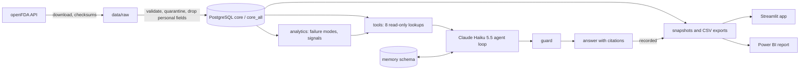

# Architecture

| Layer | Code | Notes |
|---|---|---|
| Download | `mdqc/openfda.py`, `mdqc/download.py` | paging, retries, checksums in `data/checksums.sha256` |
| Pipeline | `mdqc/schema.sql`, `mdqc/load.py`, `mdqc/load_all.py` | star schema; `core` (2022-2024) and `core_all` (2022-2026) side by side |
| Failure modes and signals | `mdqc/run_phase3.py`, `config/failure_modes.json` | codebook over FDA problem terms; Poisson rule per product, company and mode |
| Assistant | `mdqc/tools.py`, `mdqc/assistant.py` | own agent loop, prompt caching, cost ledger, budget stop, replay |
| Memory | `mdqc/memory.py` | schema `memory`, audit trail without text, real delete |
| Safety and drift | `mdqc/guardrails.py`, `mdqc/guard2.py`, `mdqc/drift.py` | guard v2 frozen; drift without a database |
| App | `app/`, `dashboards/export_snapshots.py` | reads only `dashboards/snapshots/` |
| Power BI | `dashboards/powerbi_export.py`, `dashboards/build_pbip.py` | CSV files, no database login |
| Write-up | `writeup/` | facts, renderer, verifier |

Total recorded API spend: $4.50.
