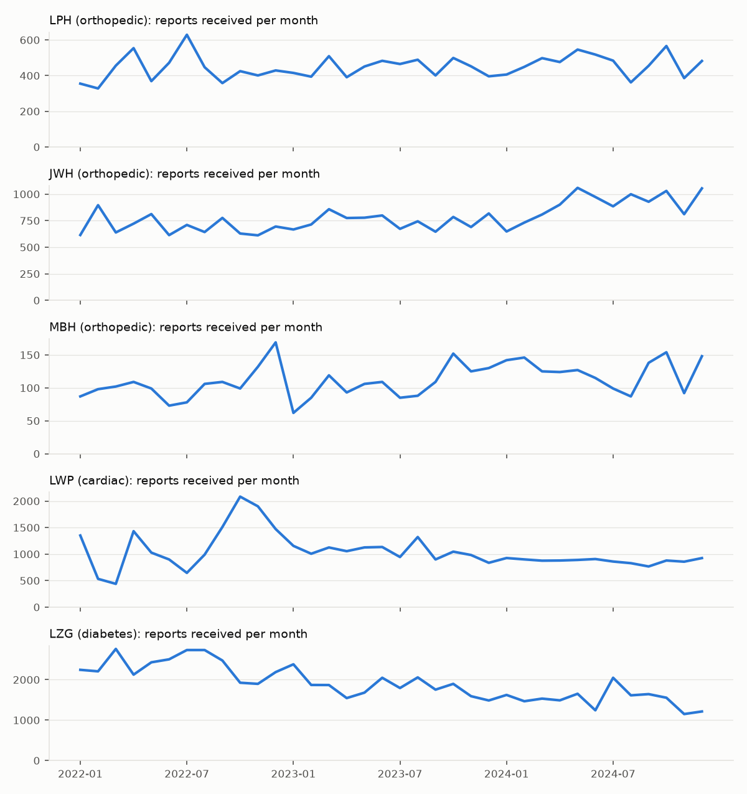
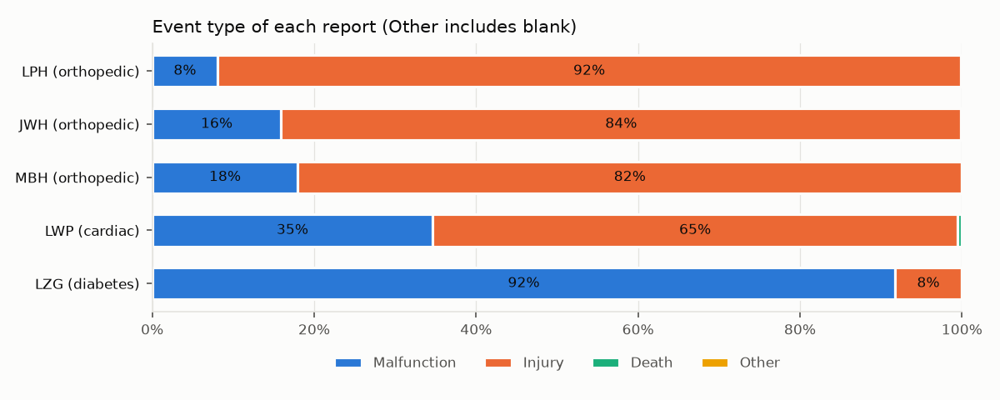
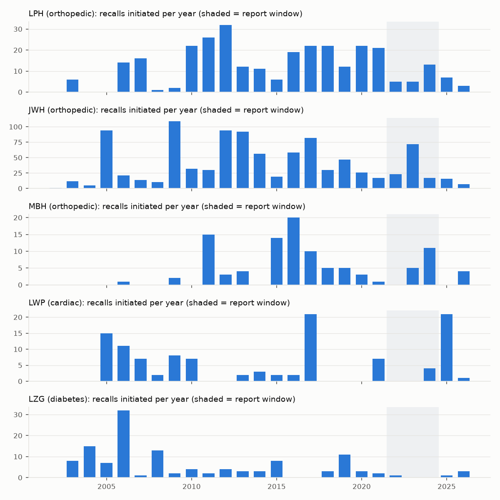

# Phase 1 findings: openFDA device data (exploratory analysis)

> Generated by `python -m mdqc.report_phase1` from `results/phase1/`. Do not edit by hand.

**Scope (pre-registered 2026-11-21, `config/scope.json`):** 5 FDA product codes, adverse-event reports received 2022-01-01 to 2024-12-31, plus every recall for those codes. **154,194 reports** (154,194 distinct report keys) and **1,626 recall records**.

**Verification:** `python -m mdqc.verify_phase1` recomputes every number below from the raw files with separate standard-library code: **8/8 checks pass** (evidence `results/phase1/verify_phase1.json`, checked 2026-11-21T19:17:27Z).

**Read every count with this in mind:** a MAUDE report says a device *may* have been involved in an event. Reports are not confirmed failures, are not proof of cause, and there is no count of devices in use, so report counts are signals, never failure rates. Large companies sell more devices and must report, so they appear more often for that reason alone.

## The data

| Code | Family | FDA device name | Reports | Recalls (all years) | openFDA data as of |
|---|---|---|---|---|---|
| LPH | orthopedic | Prosthesis, Hip, Semi-Constrained, Metal/Polymer, Porous Uncemented | 16,196 | 299 | 2026-11-11 |
| JWH | orthopedic | Prosthesis, Knee, Patellofemorotibial, Semi-Constrained, Cemented, Polymer/Metal/Polymer | 28,138 | 985 | 2026-11-11 |
| MBH | orthopedic | Prosthesis, Knee, Patello/Femorotibial, Semi-Constrained, Uncemented | 4,021 | 103 | 2026-11-11 |
| LWP | cardiac | Implantable Pulse Generator, Pacemaker (Non-Crt) | 37,414 | 113 | 2026-11-11 |
| LZG | diabetes | Pump, Infusion, Insulin | 68,425 | 126 | 2026-11-11 |

## What stands out

1. **Implants and pumps report differently.** Implant reports are mostly classed as injuries (LPH 92%, JWH 84%, MBH 82%, LWP 65%), because an implant problem that leads to another operation is reported as an injury; insulin pump reports are mostly malfunctions (LZG 92%). Raw counts must not be compared across device families.
2. **FDA problem codes are coarse.** The top term for 4 of 5 codes is "Adverse Event Without Identified Device or Use Problem" (LPH 48% of reports, JWH 42% of reports, MBH 47% of reports, LWP 32% of reports). The failure mode is in the narrative text, which every report has (median length LPH 1,724, JWH 1,710, MBH 1,493, LWP 997, LZG 791 characters). So Phase 3 groups failure modes from the text, with the FDA codes only as a weak baseline.
3. **One manufacturer often dominates a code.** Largest share: LPH DEPUY ORTHOPAEDICS INC US 54%; JWH EXACTECH, INC. 23%; MBH STRYKER ORTHOPAEDICS-MAHWAH 47%; LWP BOSTON SCIENTIFIC CORPORATION 58%; LZG INSULET CORPORATION 74%. Counts mostly reflect market share and reporting practice, so trends are read per manufacturer.
4. **No extreme monthly spikes** (no month above 3x its code's median). The busiest month was at most 2.2x its code's median, so Phase 3's signal rule must detect smaller shifts than a spike filter would.
5. **Recalls concentrate in the knees.** Recall records initiated in the report window: LPH 23, JWH 112, MBH 16, LWP 4, LZG 1. The pacemaker and insulin pump codes have few recalls in the window, so backtesting signals against recalls will rest mainly on the orthopedic codes.
6. **Implant reports arrive late.** Median lag from event to FDA receipt: LPH 22 days, JWH 26 days, MBH 24 days, LWP 21 days, LZG 12 days; 90th percentile up to 868 days. Recent months always look quieter than they will once late reports arrive, so drift monitoring (Phase 7) must allow for that.

## Checks (criteria C1-C8)

| Criterion | What was checked | Result |
|---|---|---|
| C1 | event counts = server totals at download | pass |
| C2 | recall counts = server totals | pass |
| C3 | every report in window and lists its code | pass |
| C4 | no duplicate report keys within a code | pass |
| C5 | checksums match | pass |
| C6 | independent recount of every summary number | pass |
| C7 | no data or secrets in git; contact fields counted | pass |
| C8 | published numbers = openFDA's own server-side counts (post hoc) | pass |

Every downloaded count equals the server's total for the same search at the moment of download. Raw files: `data/raw/` (11 files, 68.3 MB compressed), pinned by `data/checksums.sha256`. 153,038 reports carry manufacturer contact names or phone numbers; Phase 2 drops those fields before anything is loaded or indexed.

## Q1. Monthly report volume

| Code | Reports | Median per month | Busiest month | Months > 3x median |
|---|---|---|---|---|
| LPH | 16,196 | 451.5 | 629 (2022-07) | none |
| JWH | 28,138 | 775.5 | 1,059 (2024-05) | none |
| MBH | 4,021 | 109.0 | 169 (2022-12) | none |
| LWP | 37,414 | 935.5 | 2,084 (2022-10) | none |
| LZG | 68,425 | 1,869.0 | 2,762 (2022-03) | none |

## Q2. Event type

| Code | Malfunction | Injury | Death | Other | (blank) | Other labels |
|---|---|---|---|---|---|---|
| LPH | 1,309 (8.1%) | 14,865 (91.8%) | 21 (0.1%) | 1 (0.0%) | 0 (0.0%) | 0 |
| JWH | 4,482 (15.9%) | 23,626 (84.0%) | 21 (0.1%) | 9 (0.0%) | 0 (0.0%) | 0 |
| MBH | 723 (18.0%) | 3,298 (82.0%) | 0 (0.0%) | 0 (0.0%) | 0 (0.0%) | 0 |
| LWP | 12,960 (34.6%) | 24,249 (64.8%) | 200 (0.5%) | 5 (0.0%) | 0 (0.0%) | 0 |
| LZG | 62,799 (91.8%) | 5,574 (8.1%) | 51 (0.1%) | 1 (0.0%) | 0 (0.0%) | 0 |

## Q3. Most common FDA problem terms (number of reports listing each term, top 10 per code)

**LPH (orthopedic)**: Adverse Event Without Identified Device or Use Problem 7,781; Device Dislodged or Dislocated 3,099; Naturally Worn 942; Fracture 861; Osseointegration Problem 671; Material Erosion 429; Degraded 421; Insufficient Device Problem Information 382; Difficult to Insert 314; Migration 301. Reports with no problem term: 26.

**JWH (orthopedic)**: Adverse Event Without Identified Device or Use Problem 11,958; Naturally Worn 4,852; Fracture 3,420; Loosening of Implant Not Related to Bone-Ingrowth 2,577; Unstable 1,732; Insufficient Device Problem Information 1,517; Loss of or Failure to Bond 1,278; Appropriate Device Problem Term/Code Not Available 634; Detachment of Device or Device Component 630; Device Appears to Trigger Rejection 472. Reports with no problem term: 74.

**MBH (orthopedic)**: Adverse Event Without Identified Device or Use Problem 1,891; Fracture 578; Unstable 402; Insufficient Device Problem Information 162; Loss of Osseointegration 162; Loosening of Implant Not Related to Bone-Ingrowth 140; Difficult to Insert 113; Osseointegration Problem 99; Migration 87; Detachment of Device or Device Component 85. Reports with no problem term: 5.

**LWP (cardiac)**: Adverse Event Without Identified Device or Use Problem 11,924; Premature Discharge of Battery 6,658; Over-Sensing 3,747; Incorrect, Inadequate or Imprecise Result or Readings 3,386; Battery Problem 2,784; Defective Device 2,766; High impedance 2,369; Pacing Problem 2,360; Signal Artifact/Noise 2,236; Failure to Capture 1,876. Reports with no problem term: 146.

**LZG (diabetes)**: Unintended Movement 17,673; Loss of or Failure to Bond 15,025; Material Twisted/Bent 10,738; Failure to Fire 7,009; Insufficient Device Problem Information 4,777; Mechanical Problem 3,871; Fluid/Blood Leak 3,689; Premature Activation 3,344; Difficult to Insert 3,313; Activation, Positioning or Separation Problem 2,185. Reports with no problem term: 38.

*Correction (post hoc, 2026-11-21):* openFDA lists most problem terms twice inside one report. The first version of this doc counted list entries, which roughly doubled every term count (and overstated, for example, the share of hip reports carrying the generic term). Both the analysis and the verifier used the same wrong definition, so they agreed; a third check against openFDA's own server-side counts (verifier criterion C8, `--network`) exposed it. Terms are now counted once per report and match the server exactly.

## Q4. Manufacturers

| Code | Distinct manufacturers | Largest one's share | Top 5 (reports) |
|---|---|---|---|
| LPH | 82 | 54.2% | DEPUY ORTHOPAEDICS INC US 8,782; ZIMMER BIOMET, INC. 2,683; STRYKER ORTHOPAEDICS-MAHWAH 1,651; DEPUY IRELAND - 9616671 529; ZIMMER MANUFACTURING B.V. 345 |
| JWH | 118 | 22.7% | EXACTECH, INC. 6,372; ZIMMER BIOMET, INC. 6,290; DEPUY ORTHOPAEDICS INC US 4,650; DEPUY IRELAND - 9616671 3,672; SMITH & NEPHEW, INC. 2,483 |
| MBH | 31 | 46.9% | STRYKER ORTHOPAEDICS-MAHWAH 1,884; ZIMMER BIOMET, INC. 843; ZIMMER ORTHOPAEDIC MFG. LTD. 609; DEPUY IRELAND - 9616671 167; DEPUY ORTHOPAEDICS INC US 106 |
| LWP | 52 | 58.0% | BOSTON SCIENTIFIC CORPORATION 21,703; ST. JUDE MEDICAL, INC.(CRM-SYLMAR) 8,749; ABBOTT 4,571; MICROPORT CRM S.R.L. 739; MPRI 543 |
| LZG | 27 | 73.8% | INSULET CORPORATION 50,461; MEDTRONIC PUERTO RICO OPERATIONS CO. 11,471; ROCHE DIABETES CARE, INC. 3,816; TANDEM DIABETES CARE 1,645; MEDTRONIC MINIMED 565 |

Manufacturer names are written as reported (e.g. one company can appear under several site names); Phase 2 normalises them.

## Q5. Narrative text

| Code | Reports with narrative | Median length (characters) | 90th percentile |
|---|---|---|---|
| LPH | 100.0% | 1,724 | 3,489 |
| JWH | 100.0% | 1,710 | 2,999.3 |
| MBH | 100.0% | 1,493 | 3,224 |
| LWP | 100.0% | 997 | 2,271.8 |
| LZG | 100.0% | 791 | 1,994.6 |

## Q6. Recalls

| Code | Recall records | Distinct recall events | Initiated 2022-2024 | Top root causes |
|---|---|---|---|---|
| LPH | 299 | 105 | 23 | Packaging 67; Process control 28; Under Investigation by firm 27 |
| JWH | 985 | 288 | 112 | Other 217; Labeling design 149; Nonconforming Material/Component 94 |
| MBH | 103 | 44 | 16 | Device Design 36; Packaging 16; Use error 11 |
| LWP | 113 | 30 | 4 | Other 47; Device Design 39; Nonconforming Material/Component 9 |
| LZG | 126 | 58 | 1 | Other 63; Device Design 18; Software design 11 |

One recall event (one firm action) often covers several products, so it produces several recall records.

*Post hoc data rule:* a recall whose initiation year is missing or before 1976 (when FDA device regulation began) is treated as an invalid date, counted here and left out of the by-year counts. The verifier found this after the download: JWH 1 (a knee recall dated '0013-11-26' but posted 2013-12-13: a typo for 2013). Phase 2 may repair such dates from the posted date; Phase 1 reports them as they are.

## Q7. Reporting lag (date received minus date of event)

| Code | Reports with both dates | Median lag (days) | 90th percentile (days) | Event date after received date |
|---|---|---|---|---|
| LPH | 15,309 | 22 | 573.4 | 22 |
| JWH | 25,621 | 26 | 868 | 159 |
| MBH | 3,774 | 24 | 403.8 | 5 |
| LWP | 35,436 | 21 | 99 | 4 |
| LZG | 67,270 | 12 | 45 | 0 |

## Q8. Multi-device reports

| Code | Reports listing more than one device | Also listed under another of our codes |
|---|---|---|
| LPH | 203 | 0 |
| JWH | 115 | 0 |
| MBH | 68 | 0 |
| LWP | 53 | 0 |
| LZG | 29 | 0 |

## Why we did these tasks

| Task | Why we did it | What we learned | What it changes next |
|---|---|---|---|
| Pre-registered the scope before downloading | So the data could not be picked to flatter results | Infusion pumps alone would have been ~7x the download and dominated by one manufacturer | Every later phase uses exactly these 5 codes and this window |
| Compared every count with the server's own total | To prove nothing was lost or doubled while paging | All counts matched exactly, zero duplicates | Phase 2 can treat the raw files as the single source |
| Checksums on the raw files | To pin our copy (openFDA changes weekly) | gzip embeds a file name and time; writing neither makes checksums reproducible | Later phases check they read the same bytes |
| Answered the pre-registered questions Q1-Q8 | To learn the data's shape before modelling | Problem codes are coarse, narratives are rich, one maker often dominates, implant reports arrive late | Phase 3 groups failure modes from text; trends per manufacturer; drift checks allow for lag |
| Independent verifier | So a bug in the analysis cannot pass silently | It caught a recall dated year 0013 that the two implementations handled differently | Phase 2 adds date validation and repair rules for recall dates |
| Cross-check against openFDA's own server counts | Two programs can share the same wrong definition | Problem terms are repeated inside reports; our counts were doubled until this check | Every later verifier also compares with an outside source, not only with itself |
