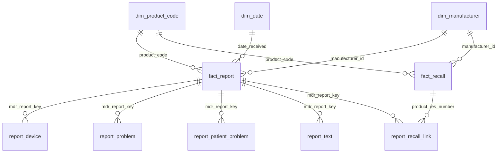

# Phase 2: PostgreSQL pipeline

> Generated by `python -m mdqc.report_phase2` from `results/phase2/`. Do not edit by hand.

**What it does:** turns the 154,194 raw adverse-event reports and 1,626 recall records from Phase 1 into a cleaned star schema in PostgreSQL (database `mdqc`, schema `core`), drops personal fields, puts every record that breaks a rule into a quarantine table with the rule it broke, merges manufacturer names into parent companies, and links reports to recalls.

**Verification:** `python -m mdqc.verify_phase2` rebuilds every table from the raw files with separate code and compares every row and column: **9/9 criteria pass** (evidence `results/phase2/verify_phase2.json`, checked 2026-11-21T19:48:19Z). Rules and criteria were committed before the first load (`config/phase2_criteria.json`, `config/manufacturer_aliases.json`).

## Schema



Two facts: one row per report (`fact_report`) and one per recall record (`fact_recall`). Report details that repeat (devices, FDA problem terms, patient problem terms, narrative texts) sit in child tables so that, for example, a problem term is counted once per report. `quarantine` keeps every rejected record with its rule; `load_run` records the raw-file checksums of the run.

| Table | Rows |
|---|---|
| fact_report | 154,193 |
| report_device | 154,680 |
| report_problem | 200,993 |
| report_patient_problem | 206,357 |
| report_text | 410,058 |
| fact_recall | 1,626 |
| report_recall_link | 531,554 |
| dim_manufacturer | 305 |
| dim_product_code | 5 |
| quarantine | 1 |

## Cleaning rules and what they caught

| Rule | Quarantined when | Records caught |
|---|---|---|
| R1 | mdr_report_key missing, or seen before in the same file | 0 |
| R2 | date_received not a valid YYYYMMDD date or outside 2022-01-01..2024-12-31 | 0 |
| R3 | no device entry carries the scope product code | 0 |
| R4 | event_type not one of Malfunction, Injury, Death, Other, or blank (blank is loaded as 'Not provided') | 0 |
| R5 | no narrative text at all | 1 |
| Q1 | product_res_number missing or duplicated | 0 |
| Q2 | event_date_initiated invalid and not repairable by the repair rule | 0 |

- Quarantined: `events_LWP.jsonl.gz` record `20466318`, rule R5 (no narrative text). This is a real report with no narrative text; Phase 1 showed '100.0% with narrative' only because one in 37,414 rounds away.

Event dates are flagged, not rejected: 147,219 ok, 6,784 missing, 190 after the date FDA received the report, 0 invalid.

Recall date repaired by the registered rule: `Z-0493-2014` invalid initiation year became 2013-11-26 (posted 2013-12-13).

**Privacy:** never loaded: every `manufacturer_contact_*` field and patient age, sex, weight, race and ethnicity (also removed from the quarantine copies). Patient information is limited to FDA patient-problem terms. Verifier criterion P3 checks the column names and searches loaded rows for the contact names and phone numbers of a sample of reports.

## Manufacturer names to parent companies

305 distinct names as written by FDA map to 101 parent companies. Cleaning removes punctuation, site numbers and legal suffixes; then registered ownership rules merge brands into parents:

| Parent | Names matched | Why |
|---|---|---|
| DEPUY SYNTHES (JOHNSON & JOHNSON) | DEPUY | DePuy is the orthopaedics company of Johnson & Johnson |
| ZIMMER BIOMET | ZIMMER, BIOMET | Zimmer and Biomet merged in 2015 |
| STRYKER | STRYKER, HOWMEDICA | Howmedica Osteonics is Stryker's orthopaedic subsidiary |
| ABBOTT | ST JUDE, ABBOTT | Abbott acquired St. Jude Medical in 2017 |
| BOSTON SCIENTIFIC | BOSTON SCIENTIFIC, GUIDANT | Boston Scientific acquired Guidant in 2006 |
| MEDTRONIC | MEDTRONIC, MINIMED | Medtronic acquired MiniMed in 2001 |
| ROCHE | ROCHE, DISETRONIC | Roche acquired Disetronic in 2003 |
| SMITH & NEPHEW | SMITH & NEPHEW, SMITH AND NEPHEW | name variants |
| MICROPORT | MICROPORT | name variants (MicroPort CRM, MicroPort Orthopedics) |
| ENCORE MEDICAL | ENCORE MEDICAL | name variants ('L.P.' / 'L.P' / 'LP') |
| TANDEM DIABETES CARE | TANDEM DIABETES | name variants |
| INSULET | INSULET | name variants |
| EXACTECH | EXACTECH | name variants |
| MANNKIND | MANNKIND | name variants ('MANNKIND CORPORATION - V-GO' with one or two spaces) |

| Code | Parent companies | Largest four (reports) | Reports under parents with < 20 reports |
|---|---|---|---|
| LPH | 33 | DEPUY SYNTHES (JOHNSON & JOHNSON) 9,822; ZIMMER BIOMET 3,112; STRYKER 1,670; ENCORE MEDICAL 575 | 81 |
| JWH | 47 | DEPUY SYNTHES (JOHNSON & JOHNSON) 8,684; ZIMMER BIOMET 7,377; EXACTECH 6,406; SMITH & NEPHEW 2,520 | 129 |
| MBH | 17 | STRYKER 1,890; ZIMMER BIOMET 1,551; DEPUY SYNTHES (JOHNSON & JOHNSON) 349; ENCORE MEDICAL 93 | 74 |
| LWP | 19 | BOSTON SCIENTIFIC 21,753; ABBOTT 13,423; MEDTRONIC 900; MICROPORT 741 | 33 |
| LZG | 13 | INSULET 50,464; MEDTRONIC 12,048; ROCHE 3,818; TANDEM DIABETES CARE 1,677 | 20 |

**Known limitation (not fixed, to keep the registered rules intact):** a small tail of misspellings and placeholders stays separate, e.g. 'OMNI LIFE SCIECE', 'DUPUY SYNTHES JOHNSON AND JOHNSON', 'UNKNOWN'. Their volume is the last column above. A later phase may add a reviewed alias list, labelled post hoc.

## Report-recall links

| Type | Rule | Links | Reports | Recalls | Median days from recall start | Range (days) | Links within a year |
|---|---|---|---|---|---|---|---|
| 510k | report.pma_pmn_number (trimmed, upper-case) is one of the recall's k_numbers AND same product code (strong link: same cleared device family) | 333,623 | 66,734 | 944 | 903 | -1,716 to 7,695 | 22,331 |
| firm_window | same product code AND same parent company AND date_received between 180 days before and 365 days after the recall's initiation date (weak link: candidate context, never proof) | 197,931 | 64,888 | 200 | 126 | -180 to 365 | 197,931 |

90,618 reports have at least one link. What the numbers mean for the assistant:

- **510(k) links are broad.** A clearance number covers a device family for years, so a report can link to recalls from long before or after it (median 903 days apart). Phase 4 tools show only links near the report date and always say what kind of link it is.
- **LWP has no 510(k) links:** pacemakers are approved through PMA ('P' numbers: 39,231 reports overall), and recall records list 510(k) numbers only, so they are linked only through the firm-and-time-window rule.
- **A link is context, never proof** that a report was caused by the recalled defect.

## Checks (criteria P1-P9)

| Criterion | What was checked | Result |
|---|---|---|
| P1 | loaded + quarantined = raw records, every file | pass |
| P2 | every loaded row and column = independent rebuild from raw | pass |
| P3 | no personal columns; contact names/phones absent from loaded rows | pass |
| P4 | second load gives identical table fingerprints | pass |
| P5 | each planted fault quarantined with its rule; clean rows still load | pass |
| P6 | manufacturer clean/parent mapping = independent application of the alias file | pass |
| P7 | invalid recall dates repaired by the registered rule or quarantined | pass |
| P8 | report-recall links = independent recomputation | pass |
| P9 | SQL reproduces Phase 1 numbers (quarantined records added back) | pass |

P10 (CI): the `pipeline` job in `.github/workflows/ci.yml` starts PostgreSQL, loads the committed fixture and runs the verifier on it (P1-P8), plus a test that a single tampered cell is detected.

## Run it

```powershell
.venv\Scripts\python -m mdqc.db_setup        # once: database mdqc + login mdqc_app, password into .env
.venv\Scripts\python -m mdqc.load            # about 1 minute
.venv\Scripts\python -m mdqc.verify_phase2   # about 2-3 minutes (reloads once to test idempotence)
.venv\Scripts\python -m mdqc.report_phase2
```

## Why we did these tasks

| Task | Why we did it | What we learned | What it changes next |
|---|---|---|---|
| Separate database and login | Projects must not share tables or passwords | An existing admin connection can create a least-privilege login once | Every later phase connects as mdqc_app |
| Pre-registered rules before the first load | So cleaning could not be tuned to make numbers look good | The registered rules caught a real report with no narrative and repaired the 0013 recall date | Rule changes from now on are labelled post hoc |
| Star schema with child tables | Counts must be right by construction (e.g. a term once per report) | Repeated FDA lists (devices, terms, texts) belong in their own tables | Phase 3 and the assistant's tools query clean, typed tables |
| Dropped personal fields at load | Privacy by default; the assistant never needs them | Contact names and phones were in 153,038 reports | Nothing downstream can leak what was never stored |
| Manufacturer parents | Trends per company need one name per company | 305 spellings became 101 parents; a small misspelled tail remains | Phase 3 signals are computed per parent company |
| Report-recall links | An investigator asks 'was there a recall for this?' | 510(k) links are broad in time; pacemakers can only link by firm and date | Phase 4 tools filter links by date and label their strength |
| Independent verifier, planted faults, tamper test | A pipeline that cannot fail its check proves nothing | All 1,127,907 rows matched; every planted fault and a single edited cell were caught | CI runs the same checks on a real PostgreSQL for every push |
